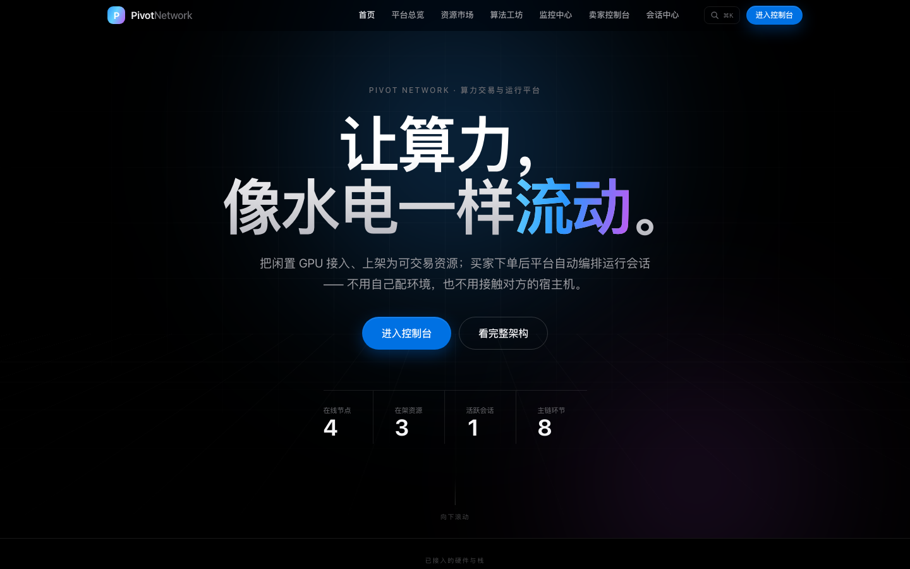
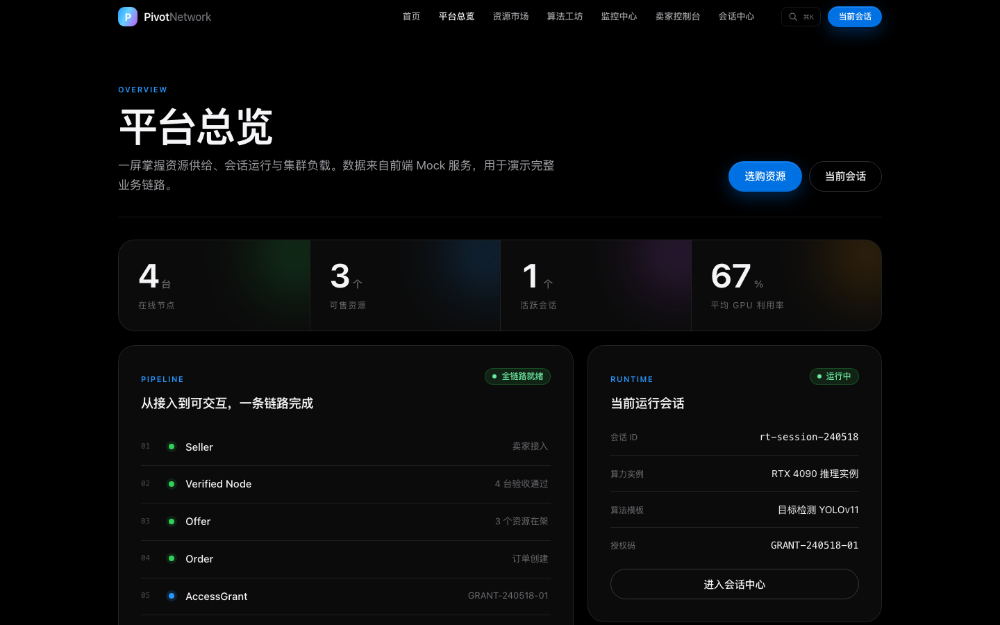
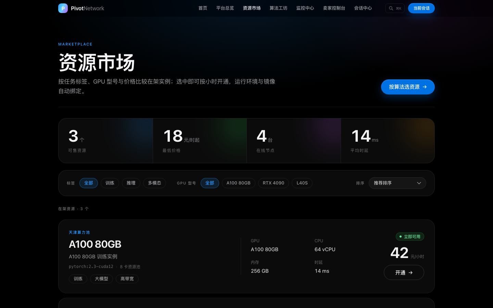
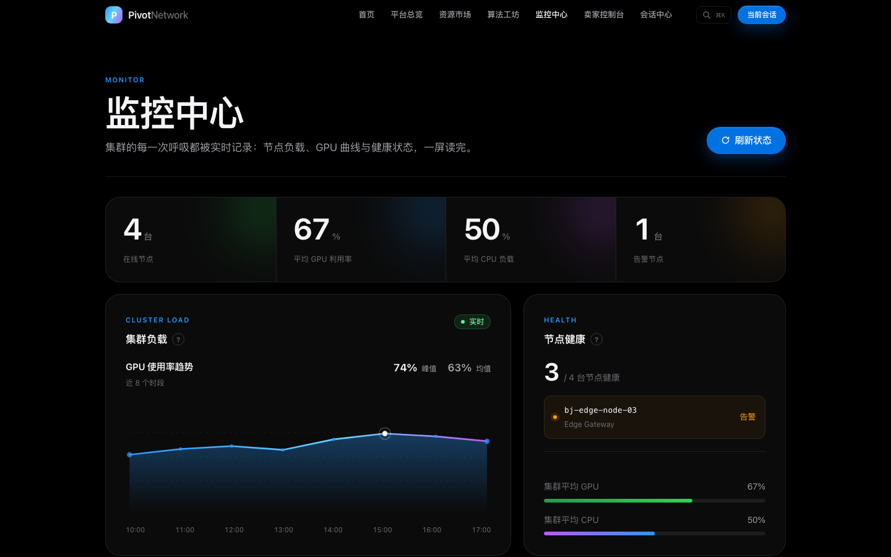
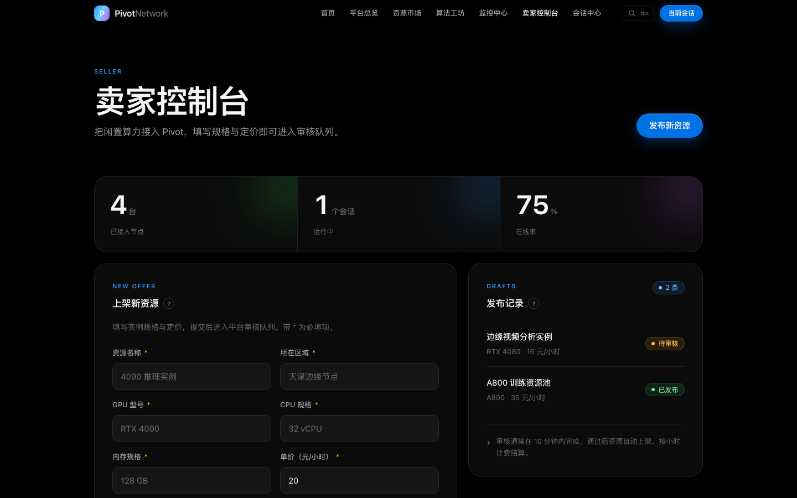
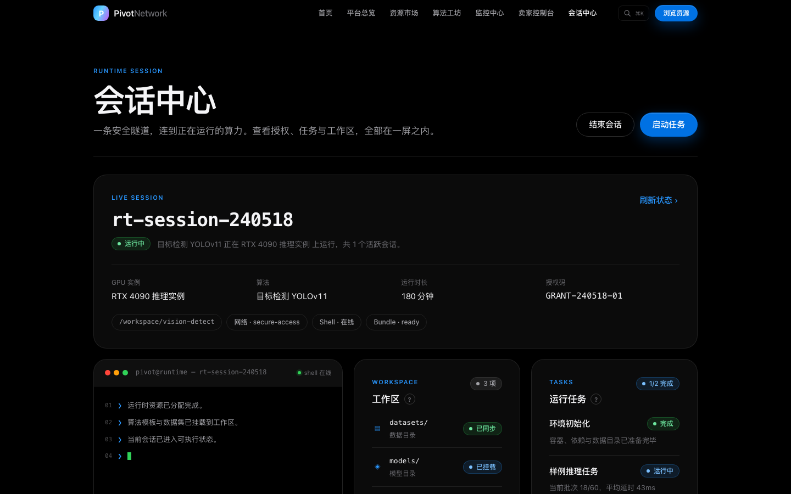
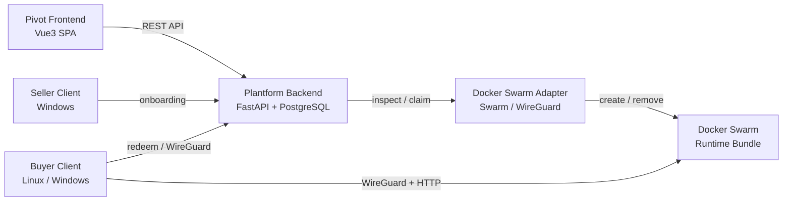

# Pivot Network

算力交易平台 —— 卖家提供 GPU 算力，买家像使用云主机一样消费它。

```text
Seller → Verified Node → Offer → Order → AccessGrant → RuntimeSession → WireGuard → Shell / Workspace / Task
```

> 前端 V2 已按 **Apple 发布会风格**完成重构：纯黑舞台、玻璃面板、滚动驱动动效、⌘K 命令面板，并新增发布会式首页 `/`。
> 设计契约见 [Apple发布会风格设计系统.md](Pivot_Network_Frontend/文档/Apple发布会风格设计系统.md)，需求依据见 [需求调研与功能分析](Pivot_Network_Frontend/文档/需求调研与功能分析-苹果发布会风格重构.md)，验收结论见 [重构验收报告](Pivot_Network_Frontend/文档/重构验收报告.md)。

## 仓库结构

```text
.
├── Pivot_Network_Frontend/   # Vue3 前端（发布会首页 + 6 个业务页面）
├── Pivot_Network_Backend/    # FastAPI + PostgreSQL + Docker Swarm + WireGuard 后端
├── README.md                 # 本文件
└── .gitignore
```

### 前端 `Pivot_Network_Frontend/`

| 页面 | 说明 |
|---|---|
| 首页 `/` | 发布会式落地页：主链叙事、痛点、六模块、安全边界、结尾 CTA |
| 平台总览 | 指标带、主链状态、当前会话、近期动态 |
| 资源市场 | GPU 资源浏览与筛选、规格对比、下单抽屉 |
| 算法工坊 | 算法模板库、任务类型筛选、绑定资源入口 |
| 监控中心 | GPU 趋势图、节点健康、负载进度条 |
| 卖家控制台 | 资源上架表单（含校验）、发布记录 |
| 会话中心 | 运行时会话、终端工作区、任务队列与授权信息 |

**V2 设计语言**

- 纯黑舞台（`#000`）+ 发丝线分区 + 玻璃面板，内容宽度 1180px
- 顶部 48px 玻璃导航取代 332px 侧栏；滚动后加发丝线，顶部有 2px 渐变进度条
- 发布会式排版：超大 Display 字号、断言式文案、每屏最多一个 Primary 按钮
- 滚动驱动动效：`v-reveal`（IntersectionObserver）+ 700ms 缓动，`prefers-reduced-motion` 下全部关闭
- 全局交互：`⌘K` 命令面板（页面 / 资源 / 算法）、面包屑式页面标题、Toast 反馈
- 响应式断点 1120 / 860 / 640，深色对比度符合 WCAG AA

**技术栈**：Vue 3.5 + Vite 7 + TypeScript 5.9 + Pinia 3 + Vue Router 4

**页面截图**（1440×900，完整截图见 [文档/截图](Pivot_Network_Frontend/文档/截图)）

| 首页 | 平台总览 |
|---|---|
|  |  |

| 资源市场 | 监控中心 |
|---|---|
|  |  |

| 卖家控制台 | 会话中心 |
|---|---|
|  |  |

### 后端 `Pivot_Network_Backend/`

- **Plantform_Backend/**: FastAPI + PostgreSQL 业务真相面
- **Docker_Swarm/**: Swarm / WireGuard / runtime adapter
- **Seller_Client/**: 卖家本地客户端（Windows）
- **Buyer_Client/**: 买家本地客户端（Linux / Windows）
- **wireguard/**: WireGuard 配置与密钥管理
- **docs/**: 教程、架构说明、runbooks

## 快速开始

### 前端

要求: Node.js >= 18

```bash
cd Pivot_Network_Frontend
npm install
npm run dev        # 开发模式 → http://127.0.0.1:5173
npm run build      # 生产构建（vue-tsc 严格模式 + vite build）
npm run preview    # 预览生产构建
```

### 后端

要求: Linux、Docker + Docker Compose

```bash
cd Pivot_Network_Backend/Plantform_Backend
cp .env.example .env
docker compose up -d --build
```

启动后:
- PostgreSQL 16: `localhost:55432`
- FastAPI: `localhost:8000`

完整链路还需要配置 Docker Swarm + Adapter + WireGuard，详见 `Pivot_Network_Backend/README.md`。

## 架构概览



## 文档索引

- [前端 README](Pivot_Network_Frontend/README.md)
- [前端设计文档（V1 基线）](Pivot_Network_Frontend/文档/Pivot前端成品设计方案-Vue3版.md)
- [Apple 发布会风格设计系统](Pivot_Network_Frontend/文档/Apple发布会风格设计系统.md)
- [需求调研与功能分析（重构依据）](Pivot_Network_Frontend/文档/需求调研与功能分析-苹果发布会风格重构.md)
- [重构验收报告](Pivot_Network_Frontend/文档/重构验收报告.md)
- [项目最终总需求文档](Pivot_Network_Frontend/文档/项目最终总需求文档.md)
- [汇报 PPT 文案](Pivot_Network_Frontend/文档/汇报PPT文案.md)
- [后端 README](Pivot_Network_Backend/README.md)
- [后端 PROJECT](Pivot_Network_Backend/PROJECT.md)
- [项目名词说明](Pivot_Network_Backend/项目名词说明.md)
- [架构说明](Pivot_Network_Backend/架构说明.md)
- [MVP 技术方案](Pivot_Network_Backend/个人算力交易平台MVP技术方案.md)

## 更新日志

### 2026-10-18 — V2 视觉重构（Apple 发布会风格）

- 新增设计底座：`tokens.css`（深色 token / 字号阶梯 / 动效曲线）、`base.css`（reset、原子类、面板、按钮、表单、reveal 动效、路由转场）
- 新增发布会首页 `/`：Hero、技术走马灯、痛点三幕、主链 8 段、六模块、安全边界、结尾 CTA
- 新增外壳：`SiteNav`（48px 玻璃导航 + 滚动进度 + 移动端菜单）、`CommandPalette`（⌘K）、`SiteFooter`
- 六页全部迁移：总览 / 资源市场 / 算法工坊 / 监控中心 / 卖家控制台 / 会话中心，统一 `PageHeader + 面板` 结构
- 下单抽屉重构：资源摘要、算法与时长选择、按实际时长计算的预估费用、链路说明
- 工程清理：删除 V1 遗留组件 `MetricCard`、`InlineExplainer`；`main.css` 收敛为样式入口，拆分 tokens/base
- 新增自动化验收：7 路由 × 2 视口构建、截图、横向溢出与控制台错误检查

### 2026-05-21 — API Service 层与骨架屏

- 前端新增 `services/api/` 的 mock / real 切换层；页面接入骨架屏与过渡动画

### 此前版本

- 前端工程化搭建、页面路由拆分、mock 数据与状态管理、买卖闭环演示
